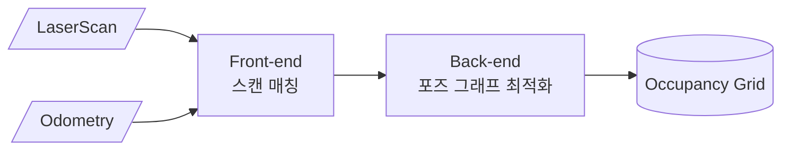

---
# 이 파일은 _로 시작해서 사이트에 나타나지 않는다. 새 글은 복사해서
# src/content/notes/<분류id>/<영문-슬러그>.mdx 로 저장한다.
title: 글 제목
description: 목록에 보이는 한두 줄 요약
category: slam # math | robotics | ros2 | perception | slam·nav2·project(ros2 하위) | control | learning | simulation
tags: [예시, 템플릿]
date: 2026-10-14
# updated: 2026-10-20
status: 학습중 # 학습중 | 정리완료
draft: false
---

import Chart from '../../components/mdx/Chart';
import NoiseFilterDemo from '../../components/widgets/NoiseFilterDemo';

{/* 인터랙티브 요소(Chart, 위젯)는 위처럼 import 하고 client:visible 을 붙인다.
    Callout · Figure · Video 는 import 없이 바로 쓸 수 있다.
    이미지는 src/assets/notes/<분류>/ 에 넣고 import 하면 자동 최적화된다:
    import mapImage from '../../assets/notes/slam/map.png'; → <Figure src={mapImage} alt="..." /> */}

## 개요

본문은 일반 Markdown으로 쓴다. **굵게**, `코드`, [링크](https://docs.ros.org) 모두 가능.

<Callout type="def" title="SLAM">
  Simultaneous Localization and Mapping. 지도를 만들면서 동시에 그 지도 안에서 자신의 위치를 추정한다.
</Callout>

## 수식

인라인 수식은 $x_{t} = f(x_{t-1}, u_t) + w_t$ 처럼 쓴다. 블록 수식:

$$
\hat{x}_{t|t} = \hat{x}_{t|t-1} + K_t \left( z_t - H \hat{x}_{t|t-1} \right)
$$

## 다이어그램

## 표

| 파라미터 | 기본값 | 의미 |
| --- | --- | --- |
| `num_range_data` | 90 | 서브맵 하나에 넣는 스캔 수 |
| `optimize_every_n_nodes` | 90 | 전역 최적화 주기 |

## 그래프

<Chart
  client:visible
  data={[
    { run: 1, 오차: 0.42, 처리시간: 0.18 },
    { run: 2, 오차: 0.31, 처리시간: 0.22 },
    { run: 3, 오차: 0.27, 처리시간: 0.29 },
    { run: 4, 오차: 0.25, 처리시간: 0.37 },
  ]}
  x="run"
  y={['오차', '처리시간']}
  xLabel="실험 회차"
  caption="실험 기록을 표 대신 그래프로"
/>

## 인터랙티브 위젯

<NoiseFilterDemo client:visible />

<Callout type="lab" title="2026-10-14">
  실험 조건, 결과, 다음에 바꿔볼 것을 짧게 남긴다.
</Callout>

## 이미지와 영상

<Figure src={`${import.meta.env.BASE_URL}favicon.svg`} alt="예시 이미지" caption="그림 설명" width={120} />

<Video src="https://www.youtube.com/watch?v=dQw4w9WgXcQ" caption="YouTube 링크 또는 public/ 아래 mp4 경로" />

<Callout type="warn">
  큰 영상 파일은 저장소에 넣지 말고 YouTube 등에 올려 링크한다.
</Callout>
