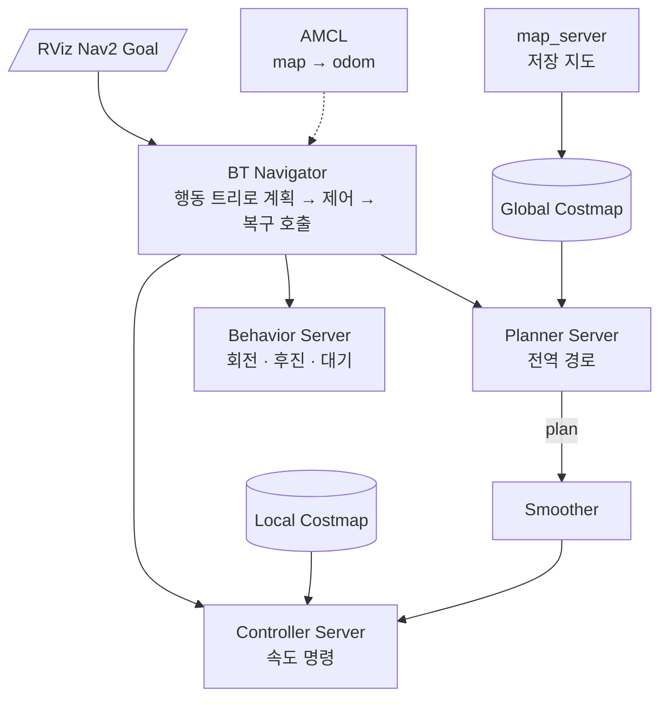
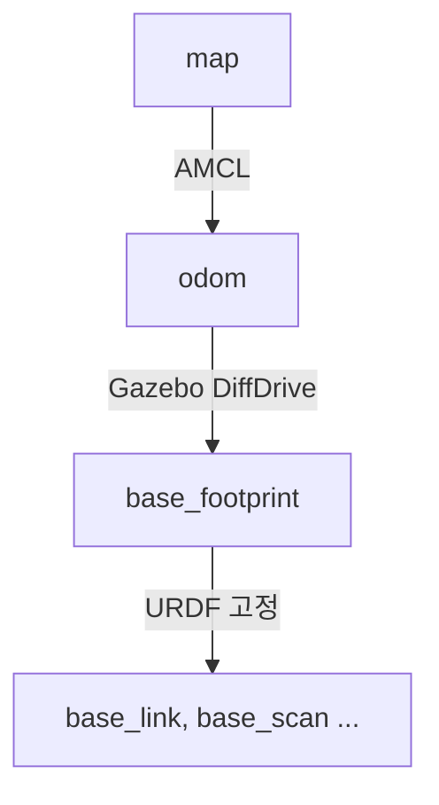
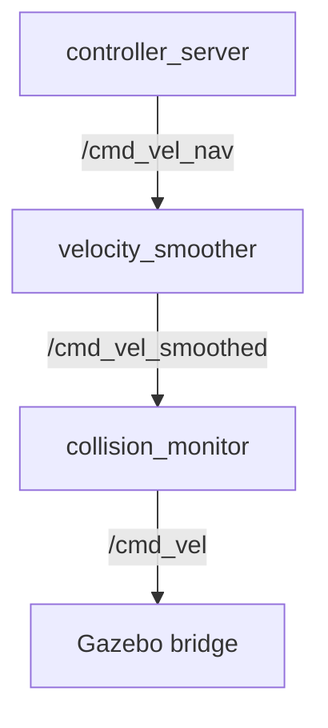
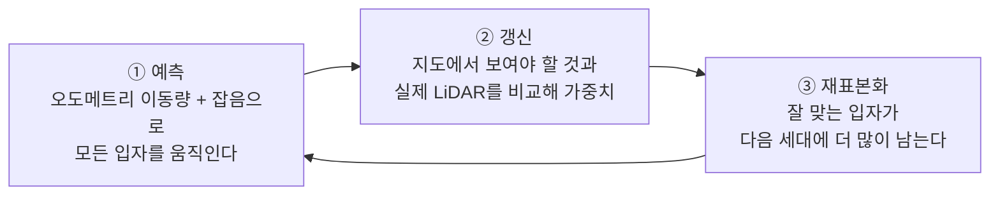
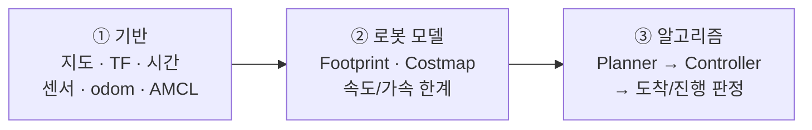

## 개요

[Cartographer 실습](../../slam/cartographer-tuning-practice/)으로 저장한 미로 지도에서,
TurtleBot3 Waffle을 Nav2로 목표 지점까지 주행시키며 정리한 내용이다.
PA Lv.2 06강 「Nav2 자율주행 — 알고리즘 선택 · AMCL · 파라미터 조정」(KANT) 교안을 공부하며 다시 구성했다.

| 질문 | 답 |
| --- | --- |
| SLAM과 Navigation의 차이는? | SLAM은 지도와 위치를 **함께** 추정한다. Navigation은 현재 위치에서 목표까지의 **경로와 속도 명령**을 만든다. |
| 저장 지도로 주행할 때 위치는 누가 추정하나? | **AMCL**. Cartographer 같은 SLAM은 꺼야 한다. |
| 경로와 속도 명령은 누가 만드나? | 경로는 **Planner**, 속도 명령은 **Controller**. 둘을 **BT Navigator**가 조율한다. |
| 파라미터는 어디부터 고치나? | 지도·TF·시간·센서·AMCL → Footprint·Costmap·속도 한계 → Planner → Controller → 도착 판정 순서. |

### 실습환경

PC와 ROS 2 설치는 [ROS 2 개발환경](../../ros2/dev-environment/)에 정리했다.

| 항목 | 내용 |
| --- | --- |
| Nav2 | 1.5.0 (NVIDIA 저장소의 Lyrical 패키지) |
| 지도 | Cartographer로 만든 Twin Closed Maze 지도 (`~/slam_maps/maze_*.pgm/.yaml`) |
| 설정 파일 | `~/slam_maps/nav2_waffle.yaml` — `nav2_bringup` 기본 YAML에서 Waffle용 frame·속도·메시지 형식만 바꾼 것 |
| 조합 | AMCL + NavFn(Dijkstra) + MPPI |

아래 표의 "현재 설정"은 이 `nav2_waffle.yaml`의 값이다(2026-10-16 확인).

## Nav2 구조

### 구성 요소



| 구성 요소 | 역할 |
| --- | --- |
| BT Navigator | 행동 트리(Behavior Tree)로 계획 → 제어 → 복구 작업을 순서대로 호출한다. |
| Planner Server | 지도 위에서 목표까지 **전역 경로**(`/plan`)를 만든다. |
| Controller Server | 경로, 현재 상태, 주변 Costmap으로 다음 **속도 명령**을 계산한다. |
| Costmap (Global / Local) | 충돌 위험과 통과 비용을 격자로 표현한다. |
| Smoother / Velocity Smoother / Collision Monitor | 경로 평활화, 명령 완화, 최종 충돌 감시. |
| Behavior Server | 실패했을 때 복구 동작(회전·후진·대기). |

### 경로(Path)와 궤적(Trajectory)

- **경로**: 공간에서 *어디를* 지나갈지(위치·방향의 열). `nav_msgs/Path`에는 속도·시간이 없을 수 있다.
- **궤적**: *언제, 어떤 속도로* 지나갈지까지 포함한다.
- Planner가 경로를 만들고, Controller가 로봇의 운동 제약과 장애물을 고려해 그 경로를 따라간다.

### TF와 속도 명령의 흐름



- `map → odom`: 저장 지도 주행에서는 **AMCL**이 전역 위치를 보정하며 발행한다.
- `odom → base_footprint`: Gazebo DiffDrive(실물이면 오도메트리)가 연속 이동을 발행한다.
- `base_footprint → 센서`: URDF의 고정 변환이다(robot_state_publisher).



속도 명령은 Waffle Lyrical Gazebo 예제에 맞춰 **`TwistStamped`** 를 쓴다. 보내는 쪽과 받는 쪽의 타입이 다르면 명령이 전달되지 않는다.

<Callout type="warn" title="SLAM에서 저장 지도 주행으로 바꿀 때">
  Cartographer를 **반드시 끈다**. AMCL과 SLAM이 동시에 `map → odom`을 발행하면 위치가 흔들린다.
  키보드 텔레옵도 끈다(같은 `/cmd_vel`에 명령이 섞인다). Gazebo·Nav2·RViz는 모두 `use_sim_time:=true`로 `/clock`을 따른다.
</Callout>

## AMCL: 저장 지도에서 위치 추정

<Callout type="def" title="AMCL">
  Adaptive Monte Carlo Localization. 이미 알고 있는 2D 지도 안에서 로봇의 $(x, y, \theta)$를 추정한다.
  가능한 위치 가설 하나하나를 **입자(particle)** 로 표현하고, 불확실성에 따라 입자 수를 늘리거나 줄인다.
</Callout>

| 방법 | 하는 일 | 한계 |
| --- | --- | --- |
| SLAM | 지도를 만들면서 위치를 찾는다 | 계산이 무겁다 |
| AMCL | 저장 지도 안에서 위치만 찾는다 | 지도를 새로 만들지 않는다 |
| Odometry | 상대 이동량을 누적한다 | 시간이 지나면 오차가 쌓인다 |

### 입자 필터 3단계



- RViz **2D Pose Estimate**로 초기 가설(위치와 방향)을 준다. 주지 않으면 AMCL은 `map → odom`을 발행하지 않는다.
- 입자가 넓게 퍼져 있으면 불확실성이 크다는 뜻이다. 한 점으로 모였다고 해서 **정답이라는 보장은 없다**.
- 반복되는 복도, 잘못된 지도, 틀린 센서 TF에서는 엉뚱한 위치로 수렴할 수 있다.

### AMCL 파라미터

**좌표계와 입력**

| 파라미터 | 현재 설정 | 의미 |
| --- | --- | --- |
| `global_frame_id` | `map` | 저장 지도 좌표계 |
| `odom_frame_id` | `odom` | 오도메트리 좌표계 |
| `base_frame_id` | `base_footprint` | 로봇 기준 frame. 실제 TF 이름과 같아야 한다 |
| `scan_topic` | `/scan` | LaserScan 토픽 |
| `robot_model_type` | `nav2_amcl::DifferentialMotionModel` | 차동 구동 모델. Omni 모델을 쓰지 않는다 |
| `tf_broadcast` | `true` | AMCL이 `map → odom`을 발행. 다른 발행자와 중복되면 안 된다 |

**입자 수**

| 파라미터 | 현재 설정 | 의미 |
| --- | --- | --- |
| `min_particles` | 500 | 최소 가설 수. 계산량에 영향 |
| `max_particles` | 2000 | 불확실할 때의 상한. 늘려도 **잘못된 지도는 해결되지 않는다** |
| `pf_err` / `pf_z` | 0.05 / 0.99 | 적응 입자 수(KLD 샘플링)의 오차·신뢰 설정 |

**이동(오도메트리) 잡음 계수 α**

| 파라미터 | 현재 설정 | 의미 |
| --- | --- | --- |
| `alpha1` | 0.2 | 회전 → 회전 오차 |
| `alpha2` | 0.2 | 병진 → 회전 오차 |
| `alpha3` | 0.2 | 병진 → 병진 오차 |
| `alpha4` | 0.2 | 회전 → 병진 오차 |
| `alpha5` | 0.2 | Omni 모델 전용. **차동 모델에서는 쓰이지 않는다** |

α를 크게 한다고 정밀해지지 않는다. 직진·회전 실험으로 실제 odom 오차 경향을 본 뒤 조정한다.

**레이저 모델**

| 파라미터 | 현재 설정 | 의미 |
| --- | --- | --- |
| `laser_model_type` | `likelihood_field` | 레이저 끝점과 가장 가까운 지도 장애물 사이의 거리로 적합도를 평가 |
| `sigma_hit` | 0.2 m | 끝점 거리 오차 분포의 폭. 너무 좁으면 작은 불일치에도 민감해진다 |
| `z_hit` / `z_rand` | 0.5 / 0.5 | 정상 관측 / 무작위 관측의 혼합 비율 |

`z_short`, `z_max`는 beam 모델 등에서 쓰는 항이다. 모든 모델의 핵심 항이 아니다.

**갱신 주기와 재표본화**

| 파라미터 | 현재 설정 | 의미 |
| --- | --- | --- |
| `update_min_d` | 0.25 m | 이만큼 움직여야 필터를 갱신 |
| `update_min_a` | 0.2 rad | 이만큼 회전해야 필터를 갱신 |
| `max_beams` | 60 | 평가에 쓸 광선 수 |
| `resample_interval` | 1 | 필터를 몇 번 갱신할 때마다 재표본화할지 |
| `transform_tolerance` | 1.0 s | 발행 TF의 유효 시간 여유. 통신 지연 자체를 고치는 값은 아니다 |

<Callout type="key" title="회전하면 스캔이 지도 벽에서 크게 벗어날 때">
  센서 TF, 메시지 시각, odom 방향, 지도 해상도부터 확인한다. 그다음 초기 위치와 모델 입력을 검증한다.
  **입자 수를 늘리는 것은 그 다음**이다.
</Callout>

## 전역 경로 계획 (Planner)

점유 지도는 칸이 비었는지 막혔는지만 표시한다. Costmap은 주행 **위험도**를 비용으로 나타내므로,
같은 거리라도 벽에 가까운 경로가 더 비쌀 수 있다.

### Dijkstra와 A*

A*는 지금까지의 누적 비용 $g(n)$에 목표까지의 예상 비용 $h(n)$을 더한 값으로 다음에 탐색할 칸을 고른다.

$$
f(n) = g(n) + h(n)
$$

Dijkstra는 $h(n) = 0$인 경우, 즉 목표 방향 정보 없이 누적 비용만으로 넓게 탐색하는 것과 같다.

| | Dijkstra | A* |
| --- | --- | --- |
| 우선순위 | 누적 비용 $g$ | $f = g + h$ |
| 특징 | 목표 방향 정보 없이 넓게 탐색 | 휴리스틱으로 불필요한 확장을 줄임 |
| 주의 | 음수가 아닌 비용에서 최소 비용 경로 | 최적성은 휴리스틱 조건과 구현에 달림. **항상 더 빠르거나 짧지는 않다** |

비교는 같은 지도와 같은 비용 조건에서, 좁은 미로와 넓은 공간을 각각 반복해서 한다.

### NavFn (현재 사용 중)

```yaml
planner_server:
  ros__parameters:
    planner_plugins: ["GridBased"]
    GridBased:
      plugin: "nav2_navfn_planner::NavfnPlanner"
      use_astar: false      # false = Dijkstra, true = A*
      allow_unknown: true   # 교안 예시는 false
      tolerance: 0.5
```

| 파라미터 | 현재 설정 | 의미 |
| --- | --- | --- |
| `use_astar` | `false` | 같은 플러그인에서 Dijkstra/A* 전환 |
| `allow_unknown` | **`true`** | 미탐색 칸 통과 허용. 교안은 미탐색 영역 통과를 막으려고 `false`를 예로 든다. Unknown을 안전한 공간으로 단정하지 않는다 |
| `tolerance` | 0.5 m | 목표가 막혔을 때 근처 끝점을 찾는 범위. **도착 허용 오차와는 다르다** |

### Planner 선택지

| Planner | 방식 | Waffle 관점 |
| --- | --- | --- |
| NavFn | Dijkstra / A* 격자 탐색 | 일반적인 출발점, 비교 실습에 적합 |
| Smac 2D | 비용 인식 A* (2D 격자) | 제자리 회전할 수 있는 차동·옴니 로봇 |
| Theta* | Any-angle(가시선) 탐색 | 격자 방향 제약 완화. 회전 가능성은 따로 점검 |
| Smac Hybrid-A* | SE(2) 탐색, Dubins / Reeds–Shepp | 최소 회전 반경이 있는 차량형 |
| Smac State Lattice | 운동 프리미티브 연결 | 로봇 모델과 격자를 맞춰야 함 |
| RRT / PRM | 샘플링 기반 | Nav2 기본 목록에 없음. 별도 통합 필요. 일반 RRT는 최적 경로를 보장하지 않음 |

Waffle은 제자리 회전이 가능하므로 **2D 계획부터 비교**한다. 차량용 제약(최소 회전 반경)을 무조건 추가하지 않는다.

플러그인 이름: `nav2_smac_planner::SmacPlanner2D`, `nav2_smac_planner::SmacPlannerHybrid`,
`nav2_smac_planner::SmacPlannerLattice`, `nav2_theta_star_planner::ThetaStarPlanner`

**Smac 주요 파라미터**

| 파라미터 | 의미 |
| --- | --- |
| `tolerance` / `allow_unknown` | 목표 부근 허용 범위, Unknown 통과 정책 |
| `cost_travel_multiplier` (2D) | 고비용 구역을 피하는 정도 |
| `max_planning_time` | 계획 시간 예산 |
| `minimum_turning_radius` (Hybrid) | 실제 조향·주행 모델에 근거한 최소 회전 반경 |
| `angle_quantization_bins` (Hybrid) | 방향 해상도. 높이면 계산량 증가 |
| `motion_model_for_search` (Hybrid) | `DUBIN`(전진만) / `REEDS_SHEPP`(전후진) |

플러그인마다 지원하는 항목이 다르다. 2D 설정을 Hybrid에 그대로 복사하지 않는다.

## 지역 제어 (Controller)

Controller는 현재 위치·속도, 경로, 주변 Costmap으로 다음 속도 명령을 만든다.
Waffle은 선속도 `vx`와 각속도 `wz`만 쓰고 **`vy = 0`** 이다.
새 장애물을 피하려면 관측 갱신과 (필요하면) 전역 재계획이 함께 작동해야 한다.

### DWB

속도 후보를 샘플링 → 짧은 궤적을 예측 → 여러 Critic이 평가 → 가중 비용이 가장 작은 후보를 고른다.

| 구분 | 파라미터 | 의미 |
| --- | --- | --- |
| 궤적 생성기 | `StandardTrajectoryGenerator` / `LimitedAccelGenerator` | 기본 rollout / 가속 한계를 반영하는 DWA 계열. DWB ≠ DWA |
| 속도·가속 | `max_vel_x`, `max_vel_theta`, `acc_lim_x`, `acc_lim_theta` | 구동계와 최종 출력 제한에 맞춘다 |
| 예측 | `sim_time` | 너무 짧으면 앞의 장애물을 늦게 고려한다 |
| 샘플링 | `vx_samples`, `vtheta_samples` | 늘리면 촘촘하지만 계산량이 는다 |
| 횡이동 | `vy_samples`, `max_vel_y` | Waffle은 `max_vel_y = 0` |
| 평가 간격 | `linear_granularity` | 너무 거칠면 충돌 평가가 부정확하다 |

| Critic | 평가 내용 |
| --- | --- |
| BaseObstacle / ObstacleFootprint | 장애물 접근·충돌 |
| PathDist / PathAlign | 경로와의 거리, 진행 방향 정렬 |
| GoalDist / GoalAlign | 목표까지 거리, 목표 방향 정렬 |
| RotateToGoal | 목표 근처에서 방향 맞추기 |
| Oscillation | 제자리 왕복 억제 |

Critic마다 `scale`의 척도가 달라 숫자만으로 비교하지 않는다. ROS 1 DWA 설정(`path_distance_bias` 등)을 그대로 옮기지 않는다.

### MPPI (현재 사용 중)

여러 **제어 시퀀스**를 샘플링 → 미래 궤적을 예측 → 비용이 낮을수록 큰 가중치로 평균 내어 시퀀스를 갱신 →
**첫 번째 제어만 적용**하고 다음 주기에 다시 계산한다.

예측 시간은 다음과 같고, 이 계산이 매 제어 주기(20 Hz = 50 ms) 안에 끝나야 한다.

$$
T = \texttt{time\_steps} \times \texttt{model\_dt} = 56 \times 0.05\ \text{s} = 2.8\ \text{s}
$$

- GPU가 필수는 아니다(벡터화 연산을 쓴다). 샘플 수·예측 길이·Critic 수가 계산 시간을 결정한다.
- "최신이라서"가 아니라 **제어 주기 안에 계산이 끝나는지**를 보고 고른다.

| 파라미터 | 현재 설정 | 의미 |
| --- | --- | --- |
| `time_steps` × `model_dt` | 56 × 0.05 s | 예측 시간 2.8 s. `model_dt`는 `controller_frequency`(20 Hz)의 주기와 맞춘다 |
| `batch_size` | 2000 | 후보 수. 늘리기 전에 제어 주기를 넘는지 잰다 |
| `vx_std` / `wz_std` | 0.2 / 0.4 | 샘플 퍼짐. 작으면 탐색이 좁고, 크면 거친 후보가 늘어난다 |
| `iteration_count` | 1 | 한 주기 안의 최적화 반복 수 |
| `temperature` | 0.3 | 낮을수록 비용이 낮은 후보에 집중 |
| `gamma` | 0.015 | 제어 에너지 정규화. Critic 가중치와는 역할이 다르다 |
| `motion_model` | `diff_drive` | Lyrical 1.5.0은 플러그인 모델 이름을 쓴다 |
| `vx_max` / `vx_min` / `wz_max` | 0.1 / -0.1 / 0.2 | 실습용 보수적 시작값(최적값 아님) |

| 활성 Critic | 평가 내용 |
| --- | --- |
| ConstraintCritic | 속도·가속 제약 위반 |
| CostCritic | Costmap 비용(장애물·고비용 구역). Footprint 설정도 확인 |
| GoalCritic / GoalAngleCritic | 목표 근처의 위치·방향 오차 |
| PathFollowCritic | 경로를 따라 앞으로 진행 |
| PathAlignCritic / PathAngleCritic | 경로 정렬, 진행 각도 |
| PreferForwardCritic | 후진을 덜 선호(금지하지는 않음) |

Critic 공통 설정: `cost_weight`(중요도), `threshold_to_consider`(조건부 평가 범위), `visualize`(예측 궤적 표시, 부담되면 끈다).

### 그 밖의 Controller

| Controller | 방식 | 언제 검토하나 | 주요 파라미터 |
| --- | --- | --- | --- |
| RPP (Regulated Pure Pursuit) | Lookahead 지점 추종 + 속도 조절 | 넓은 실내, 낮은 CPU, 정밀한 경로 추종 | 최대 선속도(Rolling: `max_linear_vel`, 이전: `desired_linear_vel`), `lookahead_dist`, `lookahead_time` |
| Graceful Controller | 부드러운 접근 제어 | 매끄럽게 접근해야 할 때 | `min_lookahead`/`max_lookahead`, `k_phi`/`k_delta`, `beta` |
| Rotation Shim | 주 Controller 전에 방향을 맞추는 **래퍼** | 출발 방향 차이가 클 때. 독립 Planner 아님 | `angular_dist_threshold`, `rotate_to_heading_angular_vel`, `primary_controller` |
| DWPP | Pure Pursuit + 속도·가속 제약 | Rolling 문서 기준 최신 기능. Lyrical 1.5.0 지원 여부를 먼저 확인 | |

어떤 알고리즘도 모든 환경에서 최고는 아니다. **로봇·경로·환경·CPU**를 근거로 고르고, 같은 속도 한계에서 비교한다.

## Costmap과 주행 품질

### Global과 Local

| | Global Costmap | Local Costmap |
| --- | --- | --- |
| 기준 frame | `map` | `odom`, Rolling Window |
| 용도 | 목표까지 경로 계획 | 로봇 주변 제어·충돌 평가 |
| 현재 레이어 | static, obstacle, inflation | voxel, inflation |
| 현재 크기 | 지도 전체 | 3 × 3 m |

레이어는 YAML에 정의만 해서는 켜지지 않는다. `plugins` 목록에 있어야 한다.

### Footprint · 해상도 · Inflation

| 파라미터 | 현재 설정 | 의미 |
| --- | --- | --- |
| `robot_radius` (또는 `footprint`) | 0.22 m | 실제 외곽과 부착물을 반영. **통로를 지나게 하려고 줄이지 않는다** |
| `resolution` | 0.05 m/cell | 작게 하면 세밀하지만 계산·메모리가 는다 |
| `inflation_radius` | 0.30 m | 장애물 주변으로 비용을 퍼뜨리는 범위. 로봇 반경과 다른 값 |
| `cost_scaling_factor` | 3.0 | 클수록 장애물에서 멀어질 때 비용이 빨리 줄어든다 |

### 센서와 장애물 제거

| 파라미터 | 의미 |
| --- | --- |
| `obstacle_max_range` | 장애물 등록에 쓸 최대 거리 |
| `raytrace_max_range` | 광선을 따라 빈 공간을 지우는 범위 |
| `marking` / `clearing` | 장애물 등록 / 해제. "유령 장애물"이 보이면 시간·TF·센서 입력도 확인 |

### 경로 평활화 (Smoother)

| Smoother | 특징 |
| --- | --- |
| Simple Smoother (현재 사용) | 격자 경로의 꺾임을 완화. 운동학 제약은 보장하지 않는다 |
| Savitzky–Golay | 국소 다항 필터로 작은 잡음 완화. `window_size`는 3 이상 홀수 |
| Constrained Smoother | 곡률·장애물·품질 최적화(`w_smooth`, `w_cost`). 계산과 설정이 복잡 |

- 행동 트리에서 `SmoothPath`를 호출하지 않으면 설정해도 적용되지 않는다.
- Hybrid·Lattice 경로는 전후진 전환점과 최소 회전 반경을 보존해야 한다(`enforce_path_inversion`).
- 평활화 후 경로가 장애물을 가로지르지 않는지 다시 확인한다.

### 도착·진행 판정

| 파라미터 | 현재 설정 | 의미 |
| --- | --- | --- |
| `xy_goal_tolerance` | 0.25 m | 목표 위치 허용 오차. NavFn `tolerance`와 다르다 |
| `yaw_goal_tolerance` | 0.25 rad | 목표 방향 허용 오차. 너무 작으면 끝에서 계속 회전한다 |
| Progress Checker | 10 s 안에 0.5 m 이동 | 저속 실습(0.1 m/s)에 맞는 판정 범위인지 검토 |

### 명령 후처리

| 노드 | 역할 | 주의 |
| --- | --- | --- |
| Velocity Smoother | 속도·가감속 제한으로 명령 완화 | Controller·구동계 한계와 일치시킨다 |
| Collision Monitor | 센서 기반 감속·정지 | 센서 사각지대와 입력 지연을 확인한다 |
| Behavior Server | 회전·후진·대기 복구 | 막힌 곳에서 무한 반복시키지 않는다 |

### 주기와 계산량

| 파라미터 | 현재 설정 | 의미 |
| --- | --- | --- |
| `controller_frequency` | 20 Hz | 주기 안에 계산이 끝나야 한다. 높인다고 좋아지지 않는다 |
| `update_frequency` | local 5 Hz / global 1 Hz | Costmap 갱신 주기 |
| `publish_frequency` | local 2 Hz / global 1 Hz | 표시·전송 주기. 내부 갱신과 별개 |

## 튜닝 방법

### 조정 순서



한 번에 한 항목만 바꾸고 결과를 기록한다.

### 증상별 점검

| 증상 | 먼저 볼 것 | 그다음 |
| --- | --- | --- |
| 벽에 너무 붙는다 | Footprint, Inflation | Planner 비용, Controller 장애물 항 |
| 코너에서 진동한다 | 위치 추정, 경로, 후보 궤적 | 속도·회전 한계와 경로/목표 Critic 사이의 충돌 |
| 명령은 있는데 안 움직인다 | `cmd_vel` 타입·토픽 (TwistStamped) | Lifecycle `active` 여부, Collision Monitor 정지 조건 |
| 위치가 틀리다 | AMCL 입력·초기 위치 | Planner를 바꾸는 것은 해결책이 아니다 |

### 알고리즘 교체와 비교 실험

- 실험마다 작업용 YAML을 복사해 보관한다(예: `navfn_dwb.yaml`, `smac_mppi.yaml`).
- Planner·Controller의 `plugin`과 **그 플러그인 전용 파라미터 묶음**을 함께 바꾼다.
- 바꾼 뒤 Nav2를 재시작하고, 플러그인 설치 여부·노드 상태·토픽 연결을 확인한다.

| 항목 | 내용 |
| --- | --- |
| 고정 조건 | 지도, 출발점, 목표, 속도 한계 |
| 기록 | 성공 여부, 시간, 거리, 진동, 최소 장애물 간격, 재계획·복구 횟수 |
| 순서 | NavFn Dijkstra ↔ A* 비교 → 그다음 Controller만 교체 |

| 단계 | 조합 | 이유 |
| --- | --- | --- |
| 첫 비교 | NavFn + MPPI | 현재 Lyrical 참고 설정. 연결과 주기부터 확인 |
| 대안 | Smac 2D / DWB / RPP | 같은 조건에서 계획 품질·추종·CPU 비교 |
| 확장 | Hybrid · Lattice · Theta* | 운동 제약·가시선·경로 품질 요구가 있을 때 |

## 실습 절차 (저장 지도 주행)

실행 전: Gazebo를 켜 두고, Cartographer와 텔레옵은 끈다. 모든 터미널의 `ROS_DOMAIN_ID`가 같아야 한다
(이 PC는 `.bashrc`의 19를 쓴다. 교안의 `export ROS_DOMAIN_ID=174`는 실행하지 않는다).

```bash
# 1) 환경 확인
MAP_YAML="$HOME/slam_maps/maze_YYYYMMDD_HHMMSS.yaml"   # 실제 파일명으로 바꾼다
ls "$MAP_YAML"
ros2 topic hz /clock
ros2 topic hz /scan
ros2 run tf2_ros tf2_echo odom base_footprint
```

```bash
# 2) Nav2 실행
ros2 launch nav2_bringup bringup_launch.py \
  map:="$MAP_YAML" params_file:="$HOME/slam_maps/nav2_waffle.yaml" \
  use_sim_time:=true autostart:=true slam:=false \
  use_localization:=true use_composition:=false \
  use_keepout_zones:=false use_speed_zones:=false
```

```bash
# 3) RViz — rviz_launch.py 대신 설정 파일로 직접 실행한다
ros2 run rviz2 rviz2 -d /opt/ros/lyrical/share/nav2_bringup/rviz/nav2_default_view.rviz \
  --ros-args -p use_sim_time:=true
```

4. **2D Pose Estimate**로 초기 위치를 주고, 스캔이 지도 벽과 겹치는지 확인한다.
5. Nav2 터미널에 `Managed nodes are active`가 두 번(localization, navigation) 나온 뒤, **Nav2 Goal**로 가까운 자유 공간을 목표로 지정한다.
6. 상태를 점검한다.

```bash
ros2 lifecycle get /amcl
ros2 lifecycle get /controller_server
ros2 topic info /cmd_vel -v
```

<Callout type="lab" title="실습 중 겪은 현상">
  - `Please set the initial pose...`가 반복된다 → 초기 위치를 안 줬다. 2D Pose Estimate로 지정한다.
  - `Timed out waiting for transform ... to map`이 나오고 `Activating planner_server`에서 멈춘다 → AMCL이 아직 `map → odom`을 내지 않았다. 초기 위치를 지정하면 자동으로 진행된다.
  - RViz에 지도가 안 보이고 Pose Estimate가 반응하지 않는다 → Lyrical의 `rviz_launch.py`는 `namespace` 기본값이 `navigation`이라 `/navigation/map` 등을 구독한다. 위 3)처럼 rviz2를 직접 실행한다.
  - `ros2 lifecycle get`에서 `Node not found` → Nav2가 실행 중이 아니거나 `ROS_DOMAIN_ID`가 다르다.
</Callout>

## 스스로 점검하기

<details>
  <summary>지도는 맞는데 로봇 위치가 틀리다. Planner부터 바꿔야 할까?</summary>
  아니다. AMCL 입력(TF·시간·스캔)과 초기 위치를 먼저 본다.
</details>

<details>
  <summary>A*로 경로가 나왔는데 로봇이 안 움직인다. 무엇을 확인할까?</summary>
  Controller 출력, `/cmd_vel` 타입(TwistStamped)과 토픽 연결, Lifecycle 상태, Collision Monitor 정지 조건.
</details>

<details>
  <summary>MPPI `batch_size`를 두 배로 늘리기 전에 무엇을 재야 할까?</summary>
  지금 제어 주기(20 Hz = 50 ms) 안에 계산이 끝나는지, 즉 controller의 처리 시간.
</details>

<Callout type="key" title="핵심 요약">
  AMCL은 저장 지도에서 **위치**를, Planner는 **경로**를, Controller는 **속도 명령**을 만든다.
  DWB·MPPI·RPP는 경로를 따라가는 방식이 서로 다르다. 알고리즘은 로봇 모델·환경·성공률·처리 시간을 근거로 고른다.
</Callout>

## 참고

- PA Lv.2 06 「Nav2 자율주행 — 알고리즘 선택 · AMCL · 파라미터 조정」 교안 (KANT, 2026-10-15)
- 예제 저장소: [SeongminJaden/waffle-lyrical-slam](https://github.com/SeongminJaden/waffle-lyrical-slam) — 저장 지도와 Nav2 주행 절차
- [Nav2 공식 문서](https://docs.nav2.org) — Configuration Guide, Tuning Guide. 설치한 Lyrical Nav2 1.5.0과 Rolling 문서는 지원 항목이 다를 수 있다.
