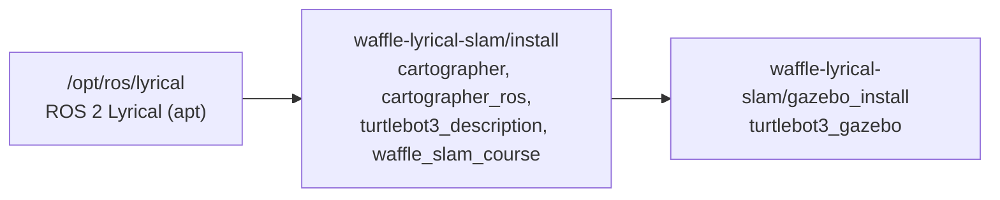

## 개요

모든 ROS 2 실습은 이 노트북 한 대에서 한다. 아래 값은 2026-10-14에 직접 확인한 것이다.
지금 이 환경으로 [Cartographer 튜닝 실습](../../slam/cartographer-tuning-practice/)을 하고 있다.

## 하드웨어

| 항목 | 내용 |
| --- | --- |
| CPU | Intel Core Ultra 9 275HX (24코어) |
| 메모리 | 32 GB |
| GPU | NVIDIA GeForce RTX 5060 Laptop GPU (8 GB) |
| GPU 드라이버 / CUDA | 595.91.07 / 13.2 |

## 운영체제와 ROS 2

| 항목 | 내용 |
| --- | --- |
| OS | Ubuntu 24.04.5 LTS (noble), 커널 7.0, GNOME (X11) |
| ROS 2 배포판 | **Lyrical Luth** (`/opt/ros/lyrical`) |
| 설치 경로 | NVIDIA Isaac ROS apt 저장소(release-5.0)의 Buildfarm 패키지 |
| 기본 패키지 | `ros-lyrical-ros-base` 0.13.0 + 필요한 패키지를 하나씩 추가 |
| 미들웨어(RMW) | Fast DDS (`rmw_fastrtps_cpp`) |
| Python / 빌드 도구 | Python 3.12.3 / colcon |
| 시뮬레이터 | Gazebo (gz-sim) 10.5.0, `ros_gz` 3.0.9 |
| 내비게이션 | Nav2 1.5.0 |
| 기타 | VS Code, Docker + NVIDIA Container Toolkit |

<Callout type="key" title="Ubuntu 24.04에서 Lyrical을 쓰는 방법">
  Lyrical의 공식 대상 OS는 Ubuntu 26.04다. 일반 ROS apt 저장소에는 24.04(noble)용 Lyrical이 없으므로,
  NVIDIA Isaac ROS 저장소가 제공하는 noble용 Lyrical 패키지를 설치했다.
  그래서 Lyrical용 바이너리가 없는 패키지(예: Cartographer)는 워크스페이스에서 소스로 빌드한다.
</Callout>

`desktop` 메타패키지는 설치하지 않았다. `ros-base` 위에 RViz, `ros_gz`, Nav2, 텔레옵 등
실습에 필요한 패키지만 `ros-lyrical-*` 이름으로 추가했다.

## 셸 설정 (`~/.bashrc`)

새 터미널을 열 때마다 아래 설정이 자동으로 적용된다.

```bash
source /opt/ros/lyrical/setup.bash

# SLAM 실습용 워크스페이스와 통신 범위
export EXP_HOME=$HOME/waffle-lyrical-slam
export ROS_DOMAIN_ID=19
source $EXP_HOME/install/setup.bash
source $EXP_HOME/gazebo_install/setup.bash

# Gazebo는 이 PC 안에서만 통신
export GZ_PARTITION=waffle_course_19
export GZ_IP=127.0.0.1
export ROS_AUTOMATIC_DISCOVERY_RANGE=LOCALHOST
```

### source 순서 (underlay → overlay)

나중에 source한 워크스페이스가 앞의 것을 덮어쓴다. 그래서 시스템 ROS를 먼저, 직접 빌드한 워크스페이스를 나중에 불러온다.



### 환경 변수

| 변수 | 값 | 이유 |
| --- | --- | --- |
| `ROS_DOMAIN_ID` | `19` | 같은 번호를 쓰는 노드끼리만 통신한다. 실습에 쓰는 모든 터미널이 같은 값이어야 한다. |
| `ROS_AUTOMATIC_DISCOVERY_RANGE` | `LOCALHOST` | 같은 네트워크의 다른 PC에 있는 ROS 노드와 섞이지 않게 한다. |
| `GZ_PARTITION` | `waffle_course_19` | Gazebo 통신을 이름으로 분리한다. 다른 Gazebo 실습과 동시에 켜도 섞이지 않는다. |
| `GZ_IP` | `127.0.0.1` | Gazebo 통신을 이 PC 안으로 제한한다. |

<Callout type="warn" title="예제 문서의 ROS_DOMAIN_ID와 다르다">
  예제 저장소의 문서는 `export ROS_DOMAIN_ID=174`를 쓴다. 이 PC는 `.bashrc`에서 19로 고정했으므로,
  예제 명령을 복사할 때 그 줄은 빼거나 19로 바꾼다. 번호가 다르면 `/map`, `/scan` 같은 토픽이 보이지 않는다.
</Callout>

<Callout type="warn" title="다른 워크스페이스를 쓸 때">
  `.bashrc`가 SLAM 실습 워크스페이스를 항상 불러온다. 다른 프로젝트의 워크스페이스를 같은 터미널에 겹쳐 source하면
  패키지가 섞일 수 있다. 다른 실습을 할 때는 `.bashrc`의 워크스페이스 줄을 주석 처리하고 새 터미널을 연다.
</Callout>

## 환경 확인 명령

```bash
echo $ROS_DISTRO                    # lyrical
printenv | grep -E '^(ROS|GZ)_'     # 위 환경 변수 확인
gz sim --versions                   # 10.5.0
nvidia-smi                          # GPU, 드라이버, CUDA 버전
```
