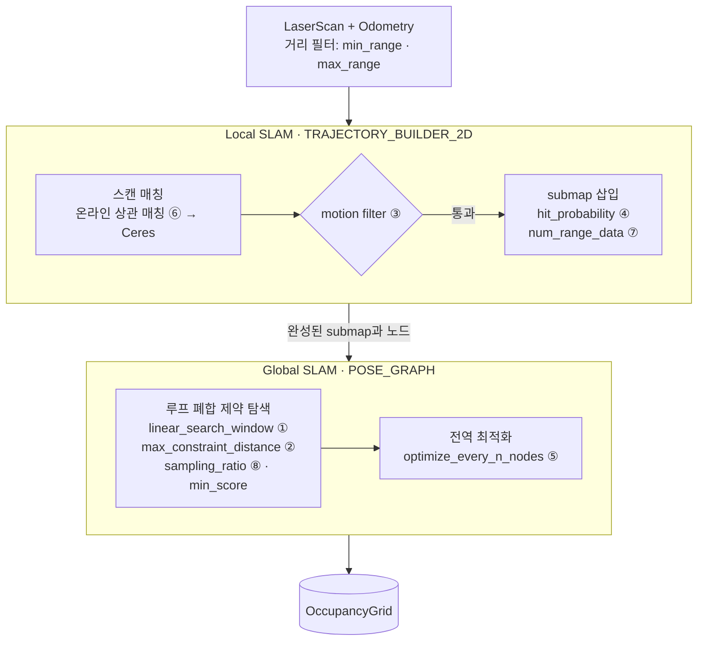

## 개요

Gazebo 미로에서 TurtleBot3 Waffle을 키보드로 몰면서 Cartographer 2D로 지도를 만들고,
설정값을 바꿔 지도 품질이 어떻게 달라지는지 비교하는 실습이다.
실습 코드는 [waffle-lyrical-slam](https://github.com/SeongminJaden/waffle-lyrical-slam) 예제를 그대로 받아 쓰고,
이 글에는 내가 정리한 설정과 실험 계획만 기록한다.

<Callout type="lab" title="진행 상황 · 2026-10-14">
  지금 쓰는 설정(`waffle_2d.lua`)을 정리하고 바꿔볼 후보 8개를 골랐다. 후보별 비교 실험은 아직 하지 않았다.
  다음 단계는 기준(baseline) 설정으로 주행해 지도를 저장하고, 후보 ①부터 하나씩 바꿔 비교하는 것이다.
</Callout>

## 실습환경

PC, OS, ROS 2 설치와 셸 설정은 [ROS 2 개발환경](../../ros2/dev-environment/)에 따로 정리했다.

| 항목 | 내용 |
| --- | --- |
| ROS 2 / 시뮬레이터 | Lyrical, Gazebo 10.5 (`ros_gz` 3.0.9) |
| 월드 | Twin Closed Maze B, 4.464 × 6.364 m, 벽 높이 0.39 m |
| 로봇 | TurtleBot3 Waffle (Jazzy 소스를 Lyrical에서 빌드) |
| LiDAR | 360점, 10 Hz, 0.12–3.5 m, 잡음 σ = 0.01 m |
| 조종 | `teleop_twist_keyboard`, 0.1 m/s · 0.2 rad/s |
| SLAM | Cartographer + cartographer_ros (ROS 2 포크 소스 빌드), 2D, IMU 미사용 |
| 통신 | `ROS_DOMAIN_ID=19`, `ROS_AUTOMATIC_DISCOVERY_RANGE=LOCALHOST` |

### 실행 순서

`.bashrc`가 ROS와 워크스페이스를 이미 불러오므로 터미널마다 아래 명령만 실행한다.

```bash
# 터미널 1: Gazebo 미로와 Waffle
ros2 launch waffle_slam_course gazebo.launch.py gui:=true

# 터미널 2: Cartographer
ros2 launch waffle_slam_course cartographer.launch.py

# 터미널 3: 키보드 조종 (i 전진, , 후진, j/l 회전, k 정지)
ros2 run teleop_twist_keyboard teleop_twist_keyboard --ros-args \
  -p stamped:=true -p frame_id:=base_footprint -p use_sim_time:=true \
  -p speed:=0.1 -p turn:=0.2

# 터미널 4: RViz (Fixed Frame = map, /map, /scan, /constraint_list 추가)
rviz2 --ros-args -p use_sim_time:=true
```

## Cartographer 구조와 파라미터 위치

Cartographer는 스캔을 바로 이어 붙이는 **Local SLAM**과, 쌓인 submap 사이의 루프 폐합을 찾아 전체를 다시 맞추는
**Global SLAM**으로 나뉜다. 아래 번호 ①–⑧은 뒤의 튜닝 후보 순위다.



## 현재 설정 (`waffle_2d.lua`)

예제의 `waffle_2d.lua`는 ROBOTIS의 TurtleBot3 설정에서 `tracking_frame`을 `base_footprint`로 바꾼 것이다.
아래 기본값은 Cartographer의 `trajectory_builder_2d.lua`, `pose_graph.lua`, `map_builder.lua` 기준이다.

### `options` (cartographer_ros)

cartographer_ros가 반드시 요구하는 값이라 기본값이 없다.

| 파라미터 | 값 | 의미 |
| --- | --- | --- |
| `map_builder` | `MAP_BUILDER` | 지도 생성기 설정 테이블 |
| `trajectory_builder` | `TRAJECTORY_BUILDER` | 궤적 생성기 설정 테이블 |
| `map_frame` | `"map"` | SLAM 지도 좌표계 |
| `tracking_frame` | `"base_footprint"` | SLAM이 추적하는 로봇 기준 frame |
| `published_frame` | `"odom"` | Cartographer가 `map→odom` TF를 발행 |
| `odom_frame` | `"odom"` | `provide_odom_frame=true`일 때만 사용 |
| `provide_odom_frame` | `false` | `odom→base_footprint`는 Gazebo가 발행 |
| `publish_frame_projected_to_2d` | `true` | 발행 pose를 2D(roll·pitch·z 제거)로 투영 |
| `use_odometry` | `true` | `/odom` 구독 |
| `use_nav_sat` | `false` | GPS 미사용 |
| `use_landmarks` | `false` | 랜드마크 미사용 |
| `num_laser_scans` | `1` | `/scan` 1개 구독 |
| `num_multi_echo_laser_scans` | `0` | multi-echo 스캔 미사용 |
| `num_subdivisions_per_laser_scan` | `1` | 스캔 분할 없음 |
| `num_point_clouds` | `0` | 포인트 클라우드 미사용 |
| `lookup_transform_timeout_sec` | `0.2` | TF 조회 대기 시간 (s) |
| `submap_publish_period_sec` | `0.3` | submap 목록 발행 주기 (s) |
| `pose_publish_period_sec` | `5e-3` | pose/TF 발행 주기 (s), 200 Hz |
| `trajectory_publish_period_sec` | `30e-3` | 궤적 시각화 발행 주기 (s) |
| `rangefinder_sampling_ratio` | `1.` | 스캔 사용 비율 |
| `odometry_sampling_ratio` | `1.` | odometry 사용 비율 |
| `fixed_frame_pose_sampling_ratio` | `1.` | fixed frame pose 사용 비율 |
| `imu_sampling_ratio` | `1.` | IMU 사용 비율 |
| `landmarks_sampling_ratio` | `1.` | 랜드마크 사용 비율 |

### 기본값을 바꾼 파라미터

| 파라미터 | 값 | 기본값 | 의미 |
| --- | --- | --- | --- |
| `MAP_BUILDER.use_trajectory_builder_2d` | `true` | `false` | 2D SLAM 사용 |
| `TRAJECTORY_BUILDER_2D.min_range` | `0.12` | `0.` | 이보다 가까운 측정 무시 (m), LiDAR 최소 거리 |
| `TRAJECTORY_BUILDER_2D.max_range` | `3.5` | `30.` | 이보다 먼 측정 무시 (m), LiDAR 최대 거리 |
| `TRAJECTORY_BUILDER_2D.missing_data_ray_length` | `3.` | `5.` | 반사가 없는 빔을 자유 공간으로 표시할 길이 (m) |
| `TRAJECTORY_BUILDER_2D.use_imu_data` | `false` | `true` | IMU 미사용 |
| `TRAJECTORY_BUILDER_2D.use_online_correlative_scan_matching` | `true` | `false` | 실시간 상관 스캔 매칭 사용 |
| `TRAJECTORY_BUILDER_2D.motion_filter.max_angle_radians` | `math.rad(0.1)` | `math.rad(1.)` | 이 각도 이상 회전하면 새 노드 삽입 |
| `POSE_GRAPH.constraint_builder.min_score` | `0.65` | `0.55` | 루프 폐합 제약 채택 최소 점수 |
| `POSE_GRAPH.constraint_builder.global_localization_min_score` | `0.7` | `0.6` | 다른 궤적과의 매칭 채택 최소 점수 |
| `POSE_GRAPH.optimize_every_n_nodes` | (주석 처리) | `90` | 전역 최적화 주기. `0`이면 global SLAM 끔 |

나머지 파라미터는 Cartographer 기본값을 그대로 쓴다.

### launch에서 지정하는 값 (`cartographer.launch.py`)

| 노드 | 파라미터 | 값 | 의미 |
| --- | --- | --- | --- |
| `cartographer_node` | `-configuration_basename` | `waffle_2d.lua` | 사용할 Lua 설정 |
| `cartographer_node` | `use_sim_time` | `True` | Gazebo `/clock` 사용 |
| `cartographer_occupancy_grid_node` | `-resolution` | `0.05` | `/map` 격자 해상도 (m/cell) |
| `cartographer_occupancy_grid_node` | `-publish_period_sec` | `1.0` | `/map` 발행 주기 (s) |
| `cartographer_occupancy_grid_node` | `use_sim_time` | `True` | Gazebo `/clock` 사용 |

## 튜닝 후보

모두 Cartographer 내부(스캔 매칭·submap·pose graph)에만 영향을 주는 값으로 골랐다.

<Callout type="warn" title="순위는 예상이다">
  이 환경에서 도움이 될 가능성이 높은 순으로 적었고, 아직 실제로 비교해 확인한 순서가 아니다.
  한 번에 하나씩 바꾸고, 같은 주행(가능하면 같은 rosbag)으로 기준 설정과 비교한다.
</Callout>

| 순위 | 파라미터 | 현재 → 제안 | 기대 효과 |
| --- | --- | --- | --- |
| ① | `POSE_GRAPH.constraint_builder.fast_correlative_scan_matcher.linear_search_window` | `7.` → `3.` | 잘못된 루프 폐합 감소 |
| ② | `POSE_GRAPH.constraint_builder.max_constraint_distance` | `15.` → `5.` | 잘못된 루프 폐합 감소 |
| ③ | `TRAJECTORY_BUILDER_2D.motion_filter.max_angle_radians` | `math.rad(0.1)` → `math.rad(1.)` | 중복 노드 감소, 벽 번짐 감소 |
| ④ | `TRAJECTORY_BUILDER_2D.submaps.range_data_inserter.probability_grid_range_data_inserter.hit_probability` | `0.55` → `0.6` | 적은 주행으로 벽이 선명해짐 |
| ⑤ | `POSE_GRAPH.optimize_every_n_nodes` | `90`(기본) → `30` | 루프 보정이 더 빨리 반영 |
| ⑥ | `TRAJECTORY_BUILDER_2D.use_online_correlative_scan_matching` | `true` → `false` | 긴 통로에서 위치 미끄러짐 감소 |
| ⑦ | `TRAJECTORY_BUILDER_2D.submaps.num_range_data` | `90` → `60` | submap 내부 누적 오차 감소 |
| ⑧ | `POSE_GRAPH.constraint_builder.sampling_ratio` | `0.3` → `0.5` | 루프 폐합 기회 증가 |

### ① `linear_search_window` 7 → 3

루프 폐합 때 현재 스캔을 과거 submap과 맞춰 볼 탐색 범위(m)다. 미로 전체가 6.4 m 이내라서
7 m면 사실상 미로 전체를 탐색한다. 미로는 비슷한 모양의 칸과 통로가 반복되므로, 다른 위치를 같은 곳으로 착각하는
**잘못된 루프 폐합**이 생길 수 있다. 이 오류는 지도를 접거나 벽을 겹치게 만들어 가장 큰 손상을 준다.
시뮬레이션 odometry는 오차가 작으므로 3 m 안에서 찾아도 진짜 폐합은 대부분 유지된다. 탐색량이 줄어 CPU도 덜 쓴다.

확인: RViz `/constraint_list`에서 멀리 떨어진 위치를 잇는 inter-constraint가 사라지는지 본다.

### ② `max_constraint_distance` 15 → 5

루프 폐합 후보로 고려할 submap의 최대 거리(m)다. 지금 값은 미로 안의 모든 submap을 후보로 만든다.
①이 "얼마나 넓게 맞춰 볼지"라면 이 값은 "어느 submap까지 후보로 볼지"다. ①을 먼저 적용하고 효과가 부족할 때 추가한다.

### ③ `motion_filter.max_angle_radians` 0.1° → 1°

회전이 이 각도를 넘으면 새 스캔을 지도에 넣는다. 0.1°는 거의 모든 스캔을 통과시킨다.
특히 정지 직전이나 저속 회전 때 같은 위치의 스캔이 반복해서 들어가 노드가 과도하게 늘고,
작은 위치 오차가 쌓여 벽이 두껍게 번질 수 있다.

1°(Cartographer 기본값)로 올려도 회전 중 삽입은 유지된다.

$$
\frac{0.2\ \text{rad/s}}{10\ \text{Hz}} = 0.02\ \text{rad} \approx 1.15^\circ \text{ / 스캔}
$$

노드 수가 줄어 최적화 부담도 줄어든다.

### ④ `hit_probability` 0.55 → 0.6

스캔이 닿은 셀을 "점유"로 올리는 강도다. 이 LiDAR는 잡음이 작아(σ = 0.01 m) 한 번의 관측도 믿을 만하다.
값을 올리면 적은 주행으로 벽이 진하게 확정된다. 지도 표현에만 영향을 준다.
너무 올리면(0.7 이상) 잘못 들어간 스캔도 지워지지 않으므로 0.6 정도에서 비교한다.
짝이 되는 `miss_probability` 0.49 → 0.45는 빈 공간을 더 빨리 지운다. 이건 따로 실험한다.

### ⑤ `optimize_every_n_nodes` 90 → 30

노드 몇 개마다 전역 최적화(루프 폐합 반영)를 할지다. 지금은 설정이 주석 처리되어 기본값 90을 쓴다.
값을 낮추면 루프를 닫은 직후 지도가 더 빨리 보정되어 RViz에서 어긋난 벽을 오래 보지 않는다.
미로가 작아 계산량 증가는 크지 않다. `0`은 전역 SLAM을 끄므로 쓰지 않는다.

### ⑥ `use_online_correlative_scan_matching` true → false

켜져 있으면 매 스캔마다 상관 탐색으로 위치를 다시 찾고, 그 결과를 Ceres 매칭의 초기값으로 쓴다.
특징이 적은 긴 직선 통로에서는 통로 방향으로 위치가 미끄러질 수 있다. 끄면 odometry 기반 예측이 초기값이 된다.
Gazebo odometry는 오차가 작아서 이쪽이 더 안정적일 수 있다.
다만 **벽에 부딪혀 바퀴가 헛도는 주행**에서는 odometry가 틀어지므로 켜 두는 편이 낫다. 그래서 순위를 중간에 두었다.

### ⑦ `submaps.num_range_data` 90 → 60

submap 하나에 넣는 스캔 수다. ③ 때문에 스캔이 거의 매번 들어가므로 submap이 빨리 찬다.
값을 줄이면 submap 안에 쌓이는 오차가 줄고 루프 폐합 단위가 촘촘해진다.
너무 작으면(30 미만) submap에 특징이 부족해 매칭이 불안정해진다. ③을 적용하면 효과가 달라지므로 그 뒤에 실험한다.

### ⑧ `constraint_builder.sampling_ratio` 0.3 → 0.5

노드 중 루프 폐합 탐색을 시도할 비율이다. 미로가 작아 계산 여유가 있으므로 올리면 폐합 기회가 는다.
대신 잘못된 폐합 시도도 늘어나므로 **①·②를 적용한 뒤에** 실험한다.

### 바꾸지 않는 값

다른 시스템(TF, Gazebo, Nav2, 저장 지도)에 영향을 주거나 위험이 큰 값이다.

| 파라미터 | 이유 |
| --- | --- |
| `map_frame`, `tracking_frame`, `published_frame`, `odom_frame`, `provide_odom_frame`, `publish_frame_projected_to_2d` | TF 트리 구성. Gazebo·RViz·Nav2와 frame이 어긋난다. |
| `use_odometry`, `use_imu_data`, `num_laser_scans` 등 센서 입력 | 구독 토픽과 TF 요구 조건이 바뀐다. |
| `pose_publish_period_sec`, `submap_publish_period_sec`, `lookup_transform_timeout_sec` | TF 발행·조회 주기. 지도 품질과 무관하고 다른 노드의 TF 수신에 영향을 준다. |
| occupancy grid 노드 `-resolution` | 저장되는 PGM/YAML 해상도가 바뀌어 Nav2 설정과 비교 기준이 달라진다. |
| `min_range`, `max_range` | LiDAR 사양(0.12–3.5 m)에 맞춘 값. 넓히면 존재하지 않는 데이터를 기대하게 된다. |
| `constraint_builder.min_score` 낮추기 | 반복 구조 미로에서 잘못된 루프 폐합 위험이 커진다. 0.65를 유지한다. |

## 실험 방법

`waffle_2d.lua`는 그대로 두고, 후보 하나만 덮어쓰는 실험 파일을 같은 `config` 폴더에 만든다.

```lua
include "waffle_2d.lua"
POSE_GRAPH.constraint_builder.fast_correlative_scan_matcher.linear_search_window = 3.
return options
```

<Callout type="key" title="실험 파일을 쓰려면">
  `cartographer.launch.py`는 `-configuration_basename`을 `waffle_2d.lua`로 고정하고 있으므로 이 값을 실험 파일 이름으로 바꾼다.
  워크스페이스는 `--symlink-install`로 빌드되어 있지만, **새로 만든 파일**은 다시 빌드해야 설치 폴더에 링크된다.
  (`colcon build --symlink-install --packages-select waffle_slam_course`)
</Callout>

## 참고

- 예제 저장소: [SeongminJaden/waffle-lyrical-slam](https://github.com/SeongminJaden/waffle-lyrical-slam) (실습에 쓴 커밋 [`c3bf041`](https://github.com/SeongminJaden/waffle-lyrical-slam/tree/c3bf041))
- [Cartographer ROS 튜닝 가이드](https://google-cartographer-ros.readthedocs.io/en/latest/tuning.html)
- [Cartographer 알고리즘 설명](https://google-cartographer-ros.readthedocs.io/en/latest/algo_walkthrough.html)
